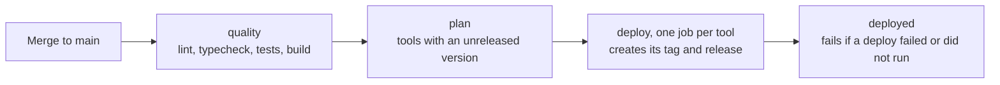

# Devtools

A monorepo for independently versioned professional tools.

## Contents

Tools by type. To use one, open its README and follow **Setup**.

### Chrome extensions

- [HeaderLab](tools/headerlab/README.md): manages request headers, query
  parameters and cookies for selected sites.
  [Setup](tools/headerlab/README.md#setup)

## Setup

Use Node.js 24 and npm. With nvm:

```sh
nvm use
npm ci
```

Installing dependencies enables the Git hooks. Pre-commit runs lint and tests.
The commit-message hook accepts a single line of at most 120 characters:

```text
feat: DEV-00000 add a tool
```

Allowed types are `feat`, `fix`, `doc`, and `chore`. The `DEV-` identifier has
exactly five digits and is assigned manually.

## Checks

```sh
npm run lint
npm run typecheck
npm test
npm run build
```

These commands check the root configuration and run the corresponding
Turborepo task in each workspace that defines it.

## Layout

- `tools/<name>/`: independently versioned tools, each with a `package.json`
  and a `README.md`. Every tool README has the same sections in the same
  order: an intro with one diagram, **Setup**, **How to use**, and **Test
  locally**. List a new tool under its type in [Contents](#contents). A tool
  with a user interface shows its version, the `version` in its
  `package.json`, in that interface.
- `packages/<name>/`: shared packages added when needed.
- `.github/workflows/`: `ci.yml` checks pull requests, `deploy.yml` releases
  tools, `deploy-<type>.yml` deploys one tool of that type, and `quality.yml`
  holds the checks both share.
- `.github/scripts/release.ts`: finds the tools to deploy and builds their tags.

Each workspace should provide `lint`, `typecheck`, `test`, and `build` scripts
as appropriate. Versions are managed independently and updated manually.

## Releases

To release a tool, raise `version` in its `package.json` and merge to `main`.
The **Deploy** workflow then runs the checks, deploys every tool whose version
has no release yet, and passes only if every deploy passed.



- **Tag**: `<category>-<name>-vMM-mm-pp`. The category is the singular of the
  top-level folder (`tools` gives `tool`), the name is the folder name, and
  the version is zero-padded: `tools/headerlab` at 0.5.0 is
  `tool-headerlab-v00-05-00`. The GitHub release has the same tag.
- **Unchanged version**: a tool changed without a version bump is not
  deployed, and the run warns about it.
- **Retry**: a failed run is repeated by the next merge, because the tool's
  version still has no release. To repeat it at once, run **Deploy** on `main`
  in GitHub Actions.
- **Pull requests**: **Deploy** rehearses the change. It builds the zip of every
  tool the pull request changes, or of every tool when the pull request
  changes `deploy*.yml` or `.github/scripts`, and keeps it as a 7-day artifact.
  It creates no tag or release.
- **Type**: each tool declares how it is deployed in its `package.json`, for
  example `"devtools": { "type": "chrome-extension" }`. The
  `chrome-extension` type builds the tool, zips `dist` and creates the release.

To add a deploy type, such as a Lambda:

1. Add the type to `deployTypes` in `.github/scripts/release.ts`.
2. Create `.github/workflows/deploy-<type>.yml`. It is a reusable workflow that
   does the deploy and creates the tag and release.
3. Add a `deploy-<type>` job to `deploy.yml`, copied from
   `deploy-chrome-extension`, and list it in the `needs` of `deployed`.

To release tools from another top-level folder, such as `scripts/`, add it to
`categories` in the same script. The tests fail until everything is wired.
GitHub loads reusable workflows only from `.github/workflows`, not from a
subfolder.

No license has been granted for this repository.
