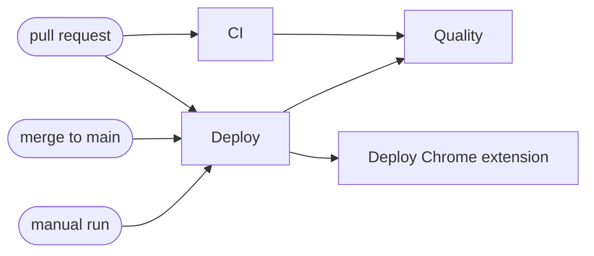

# Workflows

The automatic jobs of this repository, in plain words. Each workflow has its own
page with the same chapters: **What it does**, **Triggered**, **Diagram**,
**Jobs**, **Permissions** and **If it fails**.

## How they fit together

## Index

| Workflow | Triggered by | In one line |
| --- | --- | --- |
| [CI](ci/README.md) | a pull request | Checks the pull request. |
| [Quality](quality/README.md) | CI and Deploy | Runs lint, type check, tests and build. |
| [Deploy](deploy/README.md) | a merge, a pull request or a manual run | Releases the tools whose version has no release yet. |
| [Deploy Chrome extension](deploy-chrome-extension/README.md) | Deploy | Builds one extension and publishes it as a GitHub release. |

## What runs when

| You | What runs |
| --- | --- |
| Open or update a pull request | [CI](ci/README.md) checks it. [Deploy](deploy/README.md) rehearses the release: it builds the zip and publishes nothing. |
| Merge a pull request | [Deploy](deploy/README.md) runs the checks, then releases every tool that has a new version. |
| Click **Run workflow** on Deploy | The same as a merge. Only a run on `main` publishes. |

## Words used

| Word | Meaning |
| --- | --- |
| Workflow | A recipe that GitHub follows by itself. Each file in `.github/workflows` is one. |
| Trigger | What starts a workflow, such as a pull request or a merge. |
| Job | A group of steps that runs on its own fresh machine. |
| Reusable workflow | A workflow that other workflows call, like a function. |
| Dry run | A rehearsal. Everything runs except the publishing. |
| Gate | The last job of a run. It is green only if everything before it worked. |

## Adding or changing a workflow

1. Add or edit `.github/workflows/<name>.yml`.
2. Add or edit `docs/workflows/<name>/README.md` with the same chapters.
3. List the workflow in the index above.

The tests fail until the page exists, has the chapters in this order, and names
every trigger and every job of the YAML file. GitHub reads workflow files only
from `.github/workflows`, never from a sub-folder, so the pages live here.
