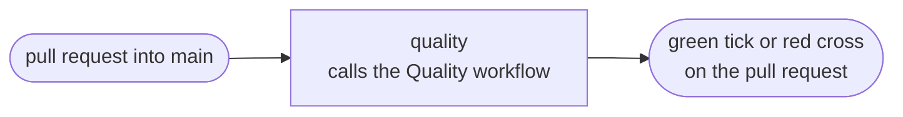

# CI

Checks every pull request, so a broken change is caught before it is merged.

Source: [.github/workflows/ci.yml](../../../.github/workflows/ci.yml)

## What it does

CI runs the repository checks on a pull request: lint, type check, tests and
build. It does this by calling the [Quality](../quality/README.md) workflow. The
result is the green tick or red cross on the pull request, named
`quality / quality`. CI never publishes anything.

## Triggered

| Event | When |
| --- | --- |
| `pull_request` | A pull request into `main` is opened, gets a new push, or is reopened. |

CI does not run when something is merged into `main`.
[Deploy](../deploy/README.md) runs the same checks there.

## Diagram

## Jobs

| Job | What it does | Time limit |
| --- | --- | --- |
| `quality` | Calls the [Quality](../quality/README.md) workflow. | 15 minutes, set in Quality |

## Permissions

Read only (`contents: read`). CI cannot change anything in the repository.

## If it fails

1. Open the failed check and find the red step: lint, type check, tests or build.
2. Run the command of that step on your machine, for example `npm run lint`.
3. Fix it, commit and push. CI starts again by itself.
4. A browser test failed once and your change cannot be the cause? Click
   **Re-run failed jobs**. If it fails again, it is real.
