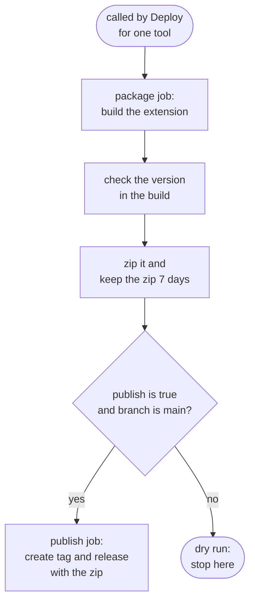

# Deploy Chrome extension

Builds one Chrome extension, zips it and publishes it as a GitHub release.

Source: [.github/workflows/deploy-chrome-extension.yml](../../../.github/workflows/deploy-chrome-extension.yml)

## What it does

For one tool, for example `tools/headerlab`, it builds the extension and checks
that the version inside the build is the version in `package.json`. Then it zips
the build and keeps the zip for 7 days. If it is allowed to publish, a second
job creates the tag and the GitHub release and attaches the zip.

There are two jobs on purpose. `package` runs `npm`, which runs other people's
code, so it can only read. `publish` can write, but runs no `npm`.

## Triggered

| Event | When |
| --- | --- |
| `workflow_call` | [Deploy](../deploy/README.md) calls it once for each tool that `plan` picked. It cannot be started by itself. |

Inputs, all required:

| Input | Meaning | Example |
| --- | --- | --- |
| `name` | Tool folder name | `headerlab` |
| `dir` | Tool folder | `tools/headerlab` |
| `version` | Version in the tool's `package.json` | `0.5.0` |
| `tag` | Release tag to create | `tool-headerlab-v00-05-00` |
| `publish` | `true` creates the tag and release. `false` is a dry run. | `true` on `main` |

## Diagram

## Jobs

| Job | What it does | Runs when | Time limit |
| --- | --- | --- | --- |
| `package` | Builds with Turborepo, checks the version, zips `dist` and uploads the zip. | Always. | 10 minutes |
| `publish` | Downloads the zip and runs `gh release create` with the tag and a short install guide. | `publish` is true and the branch is `main`. | 5 minutes |

## Permissions

`package` can only read (`contents: read`). `publish` can write contents
(`contents: write`) to create the tag and the release, and runs no `npm`.

## If it fails

| You see | It means | Do this |
| --- | --- | --- |
| `has version X but package.json has Y` | The build and `package.json` disagree on the version. | Rebuild from a clean checkout. The build must read the version from `package.json`. |
| `a release with the same tag name already exists` | That tag was already created. | Raise `version` in the tool's `package.json` and merge. |
| `package` fails while building | The tool does not build. | Run `npm run build` in the tool on your machine. |

A failed run is safe: nothing is published unless `publish` finishes. Click
**Re-run failed jobs** to try again.
