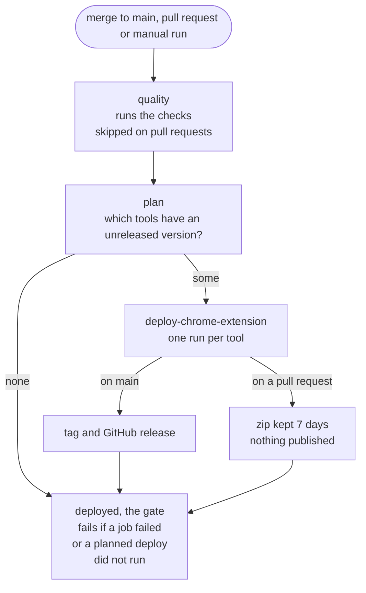

# Deploy

Releases the tools whose version has no release yet, and tags each release.

Source: [.github/workflows/deploy.yml](../../../.github/workflows/deploy.yml)

## What it does

Deploy looks at every tool and asks one question: has this version already been
released? If not, Deploy builds the tool, zips it and creates a GitHub release
with a tag such as `tool-headerlab-v00-05-00`. The tag is the folder name plus
the version written `vMM-mm-pp`: major, minor, patch.

It works in two modes:

- **On `main`** it really publishes.
- **On a pull request** it is a dry run. It builds the zip and keeps it for
  7 days, but never creates a tag or a release.

To release a tool, raise `version` in its `package.json` and merge. A tool that
changed without a new version is not released, and the run shows a warning.

## Triggered

| Event | When | Publishes? |
| --- | --- | --- |
| `push` | A pull request is merged into `main`. | Yes |
| `pull_request` | A pull request into `main` is opened or gets a new push. | No, dry run |
| `workflow_dispatch` | Someone clicks **Run workflow** on Deploy in the Actions tab. | Only when run on `main` |

Runs on the same branch queue up one after another. On a pull request, a new
push cancels the older run.

## Diagram

## Jobs

| Job | What it does | Runs when | Time limit |
| --- | --- | --- | --- |
| `quality` | Calls the [Quality](../quality/README.md) workflow. | A merge or a manual run. Not on pull requests, where [CI](../ci/README.md) already did it. | 15 minutes |
| `plan` | Lists the tools and picks the ones to deploy. | After `quality` passed, or on a pull request. | 10 minutes |
| `deploy-chrome-extension` | One run per picked tool. Calls [Deploy Chrome extension](../deploy-chrome-extension/README.md). | When `plan` picked at least one tool. | 10 and 5 minutes, set there |
| `deployed` | The gate. Fails if a job failed, or if a deploy was planned but did not run. | Always, even after a failure. | 5 minutes |

**How `plan` picks tools**

| The tool | Result |
| --- | --- |
| Has a version with no release | Deployed. |
| Has a released version and did not change | Nothing to do. |
| Has a released version but changed | Not deployed. Warning: *Version not bumped*. |
| On a pull request: changed, or the deploy files changed | Built as a dry run. |

Because a tool is deployed whenever its version has no release, a run that
failed is repeated by the next merge.

## Permissions

Read only by default. Only the `deploy-chrome-extension` job may write contents,
so that it can create the tag and the release. Inside it, only the `publish` job
uses that permission. Everything that runs `npm` stays read only.

## If it fails

| You see | It means | Do this |
| --- | --- | --- |
| `quality` is red | A check failed. Nothing was released. | Fix it, or click **Re-run failed jobs** if it was a flaky test. |
| `plan` is red | It could not read the tools or ask GitHub for releases. | Read the log, then **Re-run failed jobs**. |
| `deploy …` is red | Build, zip or publish failed for one tool. | Read the log, then **Re-run failed jobs**. If it says the release already exists, raise the version. |
| `deployed` is red | A job failed, or a deploy was planned but did not run. | Fix the job named in the message. |
| Warning *Version not bumped* | A tool changed but its version is already released. | Raise `version` in `tools/<name>/package.json` and merge. |

To repeat a release by hand, click **Run workflow** on Deploy with `main`
selected. It deploys every tool whose version has no release.
