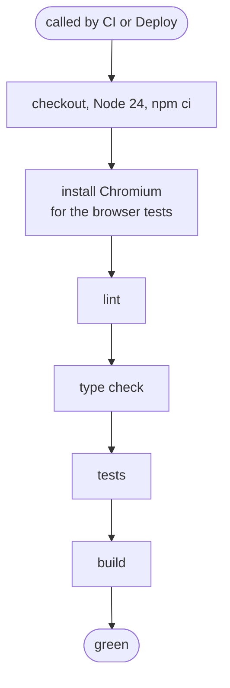

# Quality

The repository checks, written once: lint, type check, tests and build.

Source: [.github/workflows/quality.yml](../../../.github/workflows/quality.yml)

## What it does

Quality installs the project, then runs the checks one after the other. If a
check fails, the rest are skipped and the run is red. It exists so that
[CI](../ci/README.md) and [Deploy](../deploy/README.md) always run exactly the
same checks.

## Triggered

| Event | When |
| --- | --- |
| `workflow_call` | Another workflow calls it. CI calls it for every pull request. Deploy calls it for a merge or a manual run. |

It has no inputs and cannot be started by itself.

## Diagram

## Jobs

| Job | What it does | Time limit |
| --- | --- | --- |
| `quality` | Runs, in order: `npm run lint`, `npm run typecheck`, `npm test` and `npm run build`. | 15 minutes |

## Permissions

Read only (`contents: read`).

## If it fails

1. Find the red step in the log. Its name tells you which check failed.
2. Run the same command on your machine: `npm run lint`, `npm run typecheck`,
   `npm test` or `npm run build`.
3. Fix the problem and push.
4. A browser test that fails once and passes on **Re-run failed jobs** is a
   flaky test. Report it: a flaky check can hold up a release.
