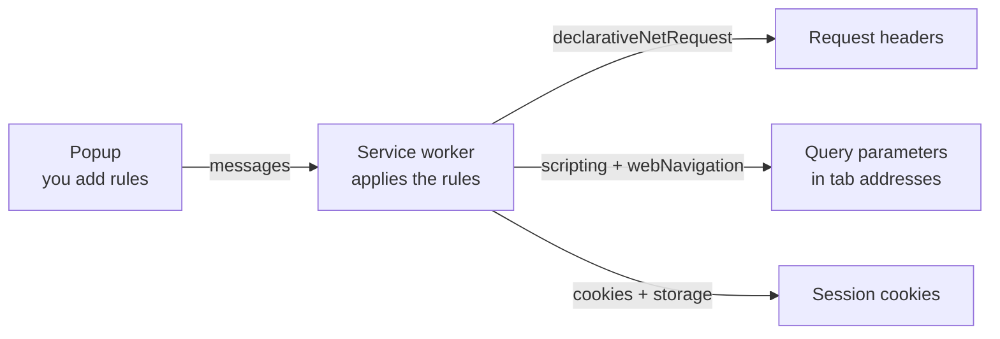

# HeaderLab

HeaderLab is a Chrome extension for testing web apps. For the sites you choose,
it changes what the browser sends: request headers, query parameters and
session cookies.



## Setup

You need Git, Node.js 24 and Google Chrome. Run the commands in a terminal
(macOS: Terminal, Windows: Command Prompt).

1. Check Git and Node.js:

   ```sh
   git --version
   node --version
   ```

   - No version printed for `git`? Install [Git](https://git-scm.com/downloads)
     and open a new terminal. On macOS, if you are offered the command line
     developer tools, click **Install**.
   - `node` must print a version that starts with `v24.`. If not, install
     Node.js 24 from <https://nodejs.org/download/release/latest-v24.x/>
     (macOS: the `.pkg` file. Windows: the `x64` `.msi` file) and open a new
     terminal. The nodejs.org home page offers a newer version that this
     project does not support. On Linux, or if `node --version` keeps printing
     an older version, use [nvm](https://github.com/nvm-sh/nvm):
     `nvm install 24`, then `nvm use 24`.

   Installers may ask for an administrator password. Ask IT if you do not have
   one.

2. Download the code. The terminal starts in your home folder, so the code is
   saved there:

   ```sh
   git clone https://github.com/Cgcnnunes/devtools.git
   cd devtools
   ```

3. Install the dependencies and build the extension:

   ```sh
   npm ci
   npm run build -w headerlab
   ```

   `npm ci` installs the exact versions the project was tested with. The build
   creates `tools/headerlab/dist`: this folder is the extension. Ignore
   vulnerability messages and do not run `npm audit fix`.

4. Add the extension to Chrome:
   1. Open `chrome://extensions` and switch on **Developer mode** (top right).
   2. Click **Load unpacked**.
   3. Open your home folder, then `devtools`, `tools` and `headerlab`. Select
      `dist` and click **Select** (Windows: **Select Folder**).

5. Pin it: click the puzzle-piece icon in Chrome's toolbar, then the pin next
   to **HeaderLab**. Click its button: a popup with **Activate** and
   **No rules yet.** opens.

Chrome runs the extension from the `devtools` folder, so do not move or delete
it.

If something goes wrong:

- `EBADENGINE` warning: Node.js is not version 24. Repeat step 1.
- `EUSAGE`, `ENOENT` or `No workspaces found` from npm: you are not in the
  `devtools` folder. Run `cd devtools`.
- `fatal: unable to access` from Git, or `ETIMEDOUT`, `ENOTFOUND`, `E403` or a
  certificate error from npm: your network blocks GitHub or the npm registry,
  as company proxies often do. The project only needs public packages from
  registry.npmjs.org. Ask IT how to set up Git and npm.
- `Manifest file is missing or unreadable` in Chrome: you did not select the
  `dist` folder, or the build did not run.
- **Developer mode** is missing or greyed out: your organization blocks
  unpacked extensions. Ask IT.

To update, untick **Activate** in the popup (HeaderLab tries to restore cookies
it replaced). In the `devtools` folder run `git pull`, `npm ci` and
`npm run build -w headerlab`. Then click **Reload** (the circular arrow) on the
HeaderLab card at `chrome://extensions` and tick **Activate** again.

To remove it, untick **Activate**, then click **Remove** on the HeaderLab card.

## How to use

Example: send the header `X-HeaderLab-Test: hello` to `example.com`.

1. Click the HeaderLab button in Chrome's toolbar.
2. Leave **Type** on **Header** and **Operation** on **Set**.
3. Enter **Header name** `X-HeaderLab-Test`, **Value** `hello` and **Site**
   `example.com`. Site is the host name only: no `https://`, no port, no path.
   **Detect** fills it in from the active tab.
4. Click **Add header**, then click **Allow** when Chrome asks for access to the
   site. If the popup closes, open it again, enter the same values and click
   **Add header** again.
5. Open `https://example.com`, press `F12` (macOS: `Cmd` + `Option` + `I`),
   select **Network**, reload the page, click the first request and look under
   **Request Headers** for `x-headerlab-test: hello`.

More:

- **Type** switches between rule kinds:
  - **Header** sets, appends or removes a request header.
  - **Query parameter** sets or removes a parameter in the address of matching
    tabs. Reload the page to send it.
  - **Cookie** creates a session cookie. HeaderLab asks before replacing an
    existing cookie and tries to restore it when the rule is switched off.
    Restarting Chrome or reloading the extension can lose the backup.
- The checkbox next to a rule turns it on or off. **Activate** at the top does
  the same for all rules. **Edit** and **Delete** change or remove a rule.
- `example.com` does not cover `www.example.com`: tick **Include subdomains**
  for that.
- To use HeaderLab in Incognito windows, switch on **Allow in Incognito** under
  **Details** on its card at `chrome://extensions`.
- Rule values are stored unencrypted and shown in the popup. Do not save
  secrets.
- Header not showing up? Check that **Activate** and the rule are ticked, that
  **Site** matches the address bar, and that DevTools was open when you
  reloaded.

## Test locally

From the `devtools` folder, install Chromium for the browser tests once, then
run the tests:

```sh
PLAYWRIGHT_SKIP_BROWSER_GC=1 npx playwright install chromium
npm test -w headerlab
```

The tests build the extension, then run unit tests and browser tests that load
the build in Chromium.

To try the popup without installing it, run `npm run dev -w headerlab` and open
the address it prints. A simulated browser stands in for Chrome, so nothing real
changes. Reload the page to reset it.

The browser tests and the simulation pre-grant site access, so also try your
build in Chrome: rebuild, then click **Reload** on the HeaderLab card at
`chrome://extensions`.
